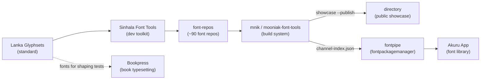

# Mooniak Font Process — Tools & Apps

A map of the repos and apps that make Sri Lankan-script type happen at Mooniak:
from the glyphset standard, through the build system, out to the apps people
actually use. Some of these are public; several are still private or
unpublished — marked below. See also the styled version of this page:
[`tools/index.html`](tools/index.html).

*Status current as of July 2026 — private repos in particular move fast.*

## How it fits together

1. **[Lanka Glyphsets](#lanka-glyphsets)** defines *what* a conformant Sinhala/Tamil
   font must contain — the glyphset tiers and the glyph naming standard.
2. **[Sinhala Font Tools](#sinhala-font-tools)** is the shared dev toolkit and
   docs layer that every font project in `font-repos/` draws on (design-stage
   tracking, test texts, glyph charts built from Lanka Glyphsets data).
3. Each typeface lives in its own repo inside the **`font-repos/`** workspace
   (~90 of them — mostly private FontMaster-legacy revivals, some public).
4. **[mnik / mooniak-font-tools](#build-tools--mnik-mooniak-font-tools)** is the
   build system that scans, builds, QAs, and proofs every repo in
   `font-repos/`, then fans its output two ways:
   - publishes a browsable status page to the public **`directory`** repo
     (src.mooniak.com), and
   - writes `channel-index.json`, the machine-readable feed **fontpipe** consumes.
5. **[fontpipe](#fontpipe)** is the distribution app: it reads that channel
   index plus each repo's `fontpackage.json`, and installs/updates fonts on a
   user's machine.
6. **[Akuru App](#akuru-app)**'s Font Library tool is the consumer-facing
   surface for that distribution — a font installer for end users, alongside
   a canvas, glossary, and text converter for Sinhala/Tamil/English work.
7. **[Bookpress](#bookpress)** sits a little to the side as a proving ground:
   a book-typesetting app that pulls real fonts (including Lanka
   Glyphsets-conformant ones) to lay out actual trilingual books.

---

## Lanka Glyphsets

**[github.com/mooniak/lanka-glyphsets](https://github.com/mooniak/lanka-glyphsets)** — `Public`

The standard everything else is built against. Defines four cumulative
Sinhala glyphset tiers (Kernel / Core / Plus / Pro, mapped to ICTA's Level
1–3 classification) plus a Tamil glyphset, and a normative glyph-naming
standard (visual-form-based, e.g. `kRa-sinh` for ක්‍ර).

Ships two packages: `@mooniak/lankaglyphsets` (npm, TypeScript reader + CLI)
and `mnik-lankafea` (PyPI, Sinhala/Tamil OpenType feature generation +
glyph-dependency validation). Also includes a HarfBuzz-based shaping
conformance checker (`tools/font-coverage/`).

**Feeds:** its generated data is vendored by Sinhala Font Tools' glyph-chart
tool; the naming standard is what individual font repos are renamed against;
Bookpress uses Lanka Glyphsets-conformant fonts for its Sinhala shaping tests.

## Sinhala Font Tools

**[github.com/mooniak/sinhala-font-tools](https://github.com/mooniak/sinhala-font-tools)** — `Public`

The shared docs-and-dev-toolkit layer for multiscript (Sinhala/Tamil/Latin)
font projects: project-status conventions (`actively-developed` →
`deprecated`), release-channel definitions (`dev` / `nightly`), a
`sinhala-composites.yaml` reference, design-stage tracking, a bank of test
texts, and browser-based tools (glyph chart, font tester) used across the
font-repos workspace.

Distinct from — but a sibling/descendant of —
[akuru/sinhala-font-tools](https://github.com/akuru/sinhala-font-tools)
("Tools, templates and specifications for sinhala font development"), the
original Akuru Collective repo Mooniak's own version grew out of.

## Build tools — mnik (mooniak-font-tools)

**[github.com/mooniak/mooniak-font-tools](https://github.com/mooniak/mooniak-font-tools)** — `Private`

The homebase for every font project. Holds no fonts itself — those live as
sibling git repos inside `font-repos/` — and instead provides `mnik`, one
Python package with three interchangeable surfaces (CLI, `Makefile`, and a
local Flask dashboard) covering the whole pipeline:

- **Build:** `build` (gftools), `collect`, `scale`, `qa` (fontspector)
- **Manifests:** `manifest`, `channel-index`, `doctor` (drift checks)
- **Sync:** pull built fonts back from CI
- **Publish:** `registry`, `showcase` (→ the public `directory` site),
  `proof-pdf`, native `export` (Glyphs.app)
- **Repo ops:** `status` / `commit` / `push` / `pull` / `template-sync` across
  every repo in the workspace at once

`channel-index.json` — aggregated per-repo, per-channel build data — is
explicitly the hand-off point: mnik's own docs describe it as "the public
data source that fontpipe consumes."

## fontpipe

Lives in **[github.com/mooniak/fontpackagemanager](https://github.com/mooniak/fontpackagemanager)** — `Private`
*(repo name predates the product name; the binary, crates, and README all say "fontpipe")*

A GitHub-native font package manager — a Tauri 2 desktop app (Rust + React)
that subscribes to font repositories via a `fontpackage.json` manifest
standard, installs fonts system-wide, and auto-updates across release / dev /
nightly channels. Handles per-OS font activation natively (CoreText on
macOS, GDI on Windows).

**Consumes:** `channel-index.json` from mnik. **Feeds:** the installer engine
behind Akuru App's Font Library tool.

## Bookpress

**No public repo yet — local-only, not pushed to GitHub.**

A book-typesetting desktop app for publishers, built on Tauri 2 with the
Typst compiler embedded natively in the Rust backend
(structured-model-as-truth: a structured book model is the source of truth,
with deterministic one-way codegen to Typst). Ships live per-page SVG
preview, click-to-jump editing, font management (embedded + system + project
fonts), PDF export, and autosave/crash recovery.

Its font-handling test suite specifically exercises Sinhala shaping using
Lanka Glyphsets-conformant fonts — making it the most concrete real-world
consumer of the whole standard-to-font pipeline, laying out actual trilingual
(Sinhala/Tamil/English) books rather than just rendering type specimens.

## Akuru App

Landing/waitlist page: **[github.com/mooniak/akuruapp-landing](https://github.com/mooniak/akuruapp-landing)** — `Public`
The app itself — `Unpublished` (alpha, no public source repo; [waitlist](https://forms.gle/9D8DZY5xeRqGxFAFA))

A desktop "super app" for individuals, businesses, and organisations working
with text, fonts, and writing in Sri Lanka's official languages. The alpha
ships four tools: a **font library** (font installer — Google Fonts today,
expanding to Mooniak's own catalogue), a **canvas** for trying fonts without
installing, a **glossary** of official-language technical terms, and a
Sinhala ASCII→Unicode **text converter**.

The font library is the natural end-user face of fontpipe's distribution
technology — where the standard (Lanka Glyphsets), the build system (mnik),
and the distribution app (fontpipe) ultimately reach a reader who just wants
a working font.

---

## Also worth knowing about

**[directory](https://github.com/mooniak/directory)** — `Public` (src.mooniak.com)
The public showcase for every Mooniak typeface — a static Astro site with no
backend of its own. Its `public/data/` is entirely generated and pushed by
`mnik showcase --publish` from mooniak-font-tools; nothing under it is
hand-edited. This is the visible, human-facing output of the build pipeline
described above.
